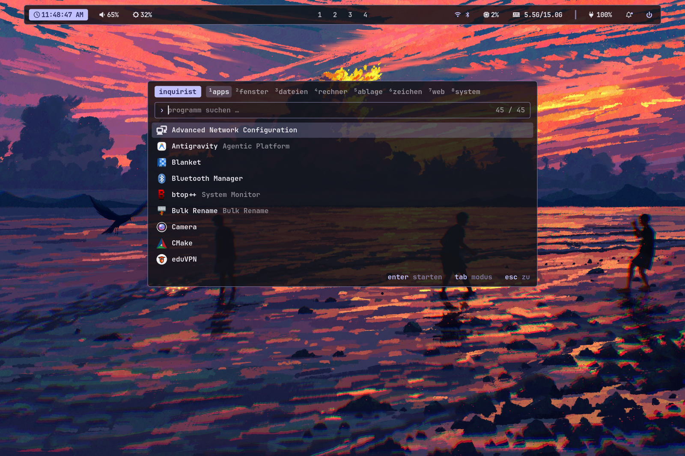
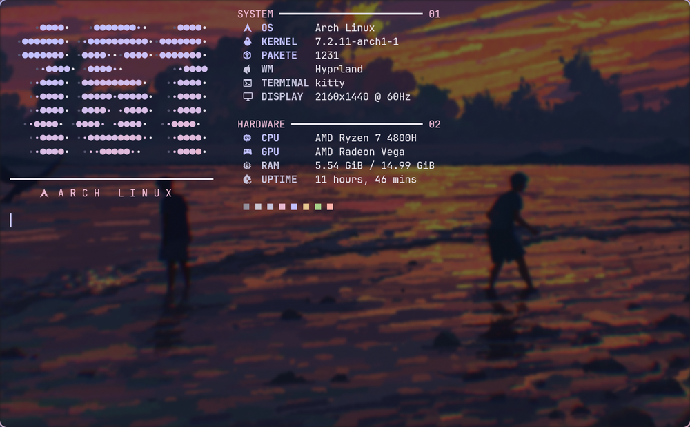
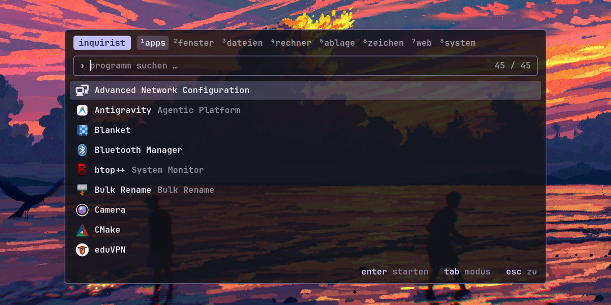
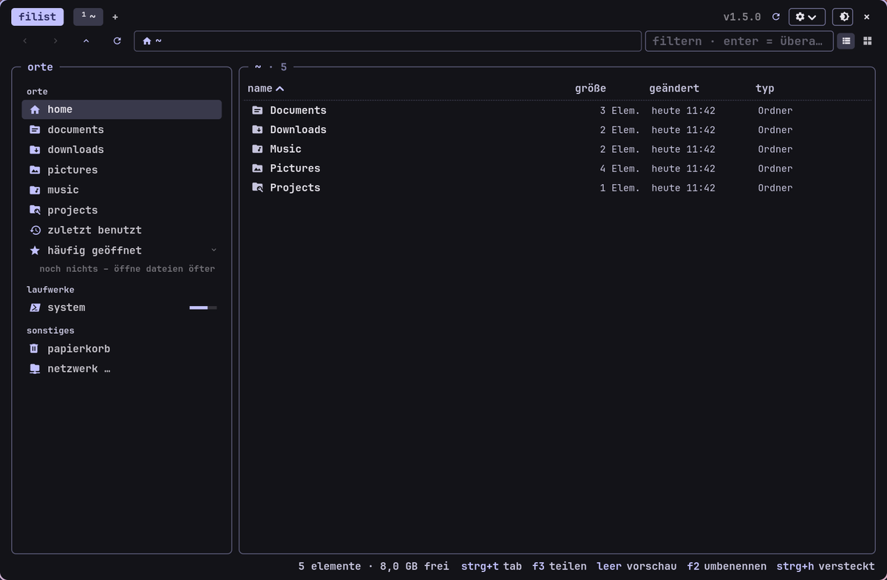
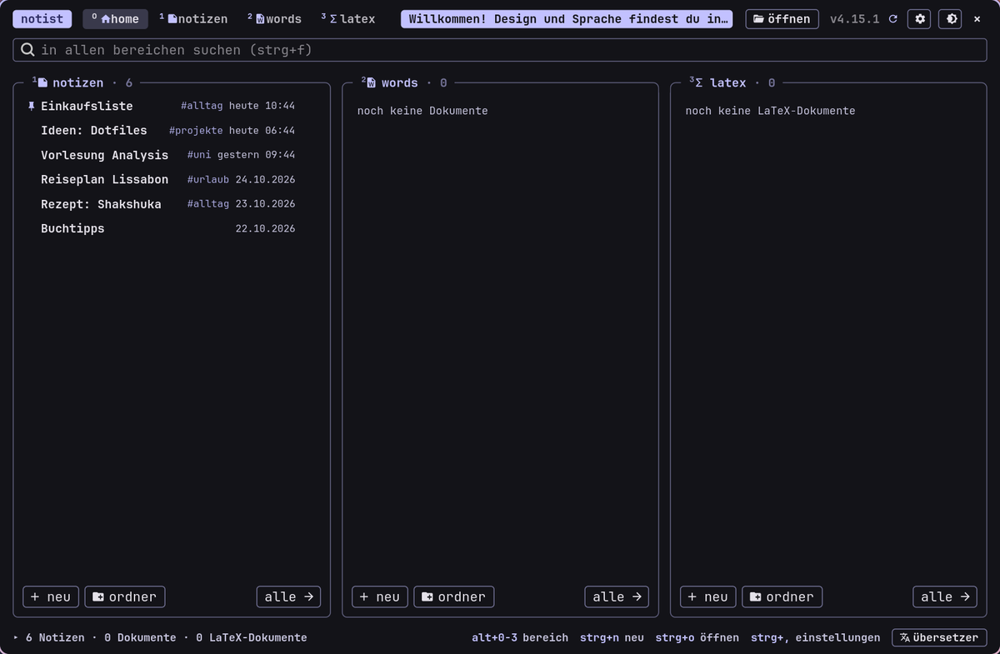
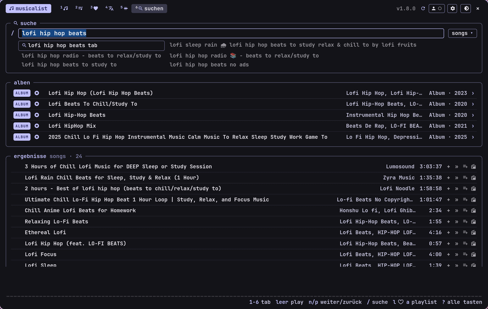
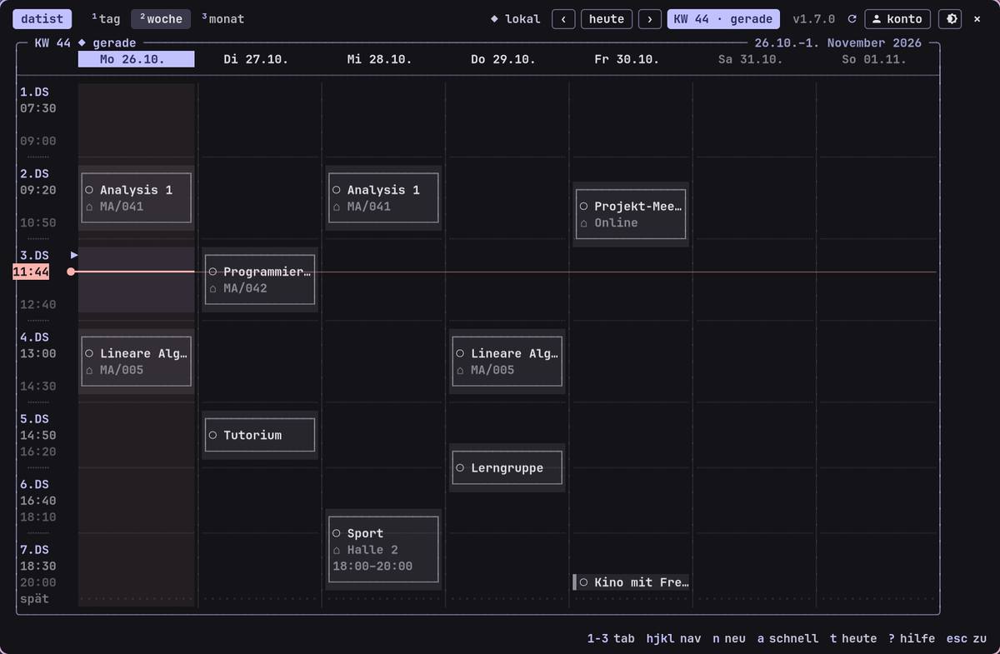
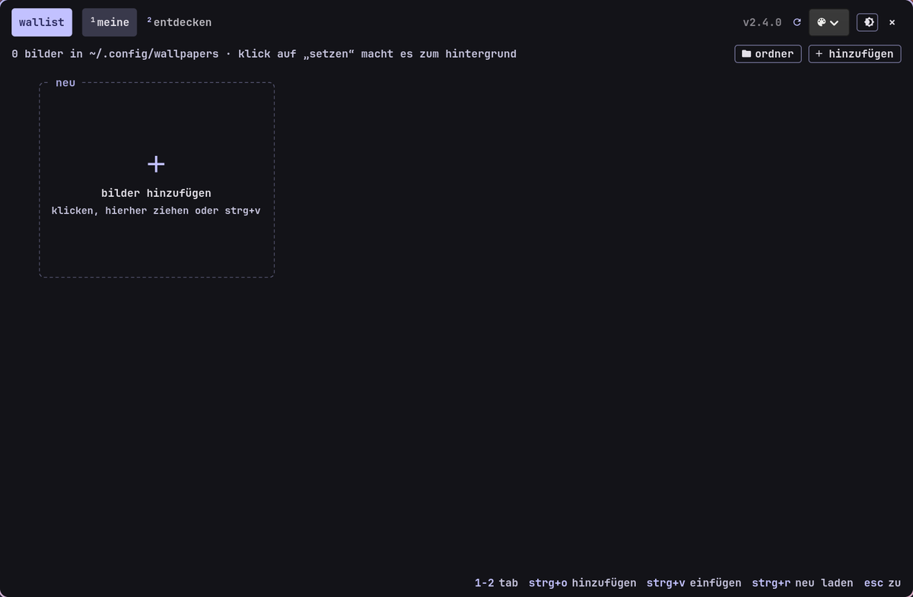

<div align="center">

# dotfiles

**hyprland on arch, colors from the wallpaper, and the -ist app suite on top**

    



<sub>wallpaper: [Fangpeii](https://www.pixiv.net/artworks/120232182) · via [wallhaven](https://wallhaven.cc/w/rr1kow)</sub>

</div>

## setup

* **wm** – [hyprland](https://hyprland.org/), configured in lua (`.config/hypr/hyprland.lua`)
* **panel / lock / idle** – [waybar](https://github.com/Alexays/Waybar) (three switchable styles), swaync notifications, hyprlock, hypridle; [rofi](https://github.com/davatorium/rofi) is the launcher (inquirist), wofi the small waybar popup menus
* **terminal** – kitty with fish and starship, system info with fastfetch
* **monitoring** – btop
* **colors** – [matugen](https://github.com/InioX/matugen) turns the current wallpaper into one palette for hyprland borders, kitty, btop, hyprlock and the apps
* **light / dark** – `super+shift+w` switches the whole desktop and all apps at once. A scan bar sweeps across the screen (grim screenshot on a layer-shell overlay, `ist-swipe.py`); on/off and duration are in the design picker of every app. The hyprland layer rule `no-anim-ist-swipe` keeps waybar from flashing
* **font** – JetBrains Mono (nerd font), everywhere
* **launcher, files, notes, mail, music …** – the [-ist suite](#apps), own gtk4 apps that follow the same palette

<p align="center"></p>
<p align="center"><sub>wallpaper: [Fangpeii](https://www.pixiv.net/artworks/120232182) · via [wallhaven](https://wallhaven.cc/w/rr1kow)</sub></p>

## apps

all of them take their colors from the wallpaper, share one installer and open with a `super` shortcut.

| | app | keys | |
| --- | --- | --- | --- |
|  | **[inquirist](https://github.com/danger-inc/inquirist)** – launcher with modes | `super+r` | apps, windows, files, calculator, clipboard |
|  | **[filist](https://github.com/danger-inc/filist-public)** – file explorer | `super+e` | tabs, split view, preview, file dialog for every app |
|  | **[notist](https://github.com/danger-inc/notist-public)** – notes, words, latex | | one app, three ways to write |
|  | **[mailist](https://github.com/danger-inc/mailist-public)** – mail | `super+g` | gmail + imap, several accounts, openpgp |
|  | **[sharist](https://github.com/danger-inc/sharist)** – quick share | `super+d` | send files and text to phones nearby |
|  | **[musicalist](https://github.com/danger-inc/musicalist-public)** – youtube music | `super+m` | search, queue, lyrics, hover preview |
|  | **[datist](https://github.com/danger-inc/datist)** – calendar | `super+k` | week/month grid, google sync |
|  | **[linguist](https://github.com/danger-inc/linguist)** – translator | `super+t` | offline dictionary, hover corner |
|  | **[wallist](https://github.com/danger-inc/wallist)** – wallpapers | `super+w` | collect, set, discover |
|  | **[scourge](https://github.com/danger-inc/scourge-public)** – toolbox | | files, pdf, video, screen recording; installs the others |

<sub>tip: the glass button (󰃝, top right in every app) makes the windows see-through like the terminal – needs a compositor with blur, e.g. hyprland. the inquirist screenshot shows the same wallpaper as above (credit there).</sub>


## layout

the repo mirrors the home directory, so a path here is the path in `~`:

```
.config/
├── hypr/        hyprland.lua + modules, hyprlock, hypridle, shaders, helper scripts
├── matugen/     color templates (hyprland, kitty, btop, hyprlock, rofi, gtk css)
├── kitty/       terminal
├── btop/        monitor (theme is generated)
├── fastfetch/   system info with the custom logo
├── fish/        shell
└── starship.toml
sync.sh          copy the live config from ~/.config into this repo (home paths → @HOME@)
install.sh       link/render the files into ~ (existing files go to ~/.dotfiles-backup)
links.txt        what sync.sh and install.sh handle
packages.txt     arch packages the setup needs (packages-aur.txt: aur ones)
.githooks/       privacy check: no home paths, mail addresses, tokens
```

## install

```bash
git clone https://github.com/danger-inc/dotfiles ~/dotfiles
cd ~/dotfiles
grep -v '^#' packages.txt | sudo pacman -S --needed -   # dependencies (official repos)
# optional, needs an aur helper (yay is not part of arch; install it first, or build the two packages by hand):
grep -v '^#' packages-aur.txt | yay -S --needed -      # wlogout, zen-browser
./install.sh --dry-run                # look first
./install.sh                          # all, or: ./install.sh hypr kitty
```

* install at least one app of the [-ist suite](#apps) first (e.g. `wallist`, which also manages your wallpapers): the waybar menus use the shared `tui.py` that the apps ship.
* files under `~/.local` are copied (the apps update some of them), the rest without a home path is **symlinked** (edit in the repo or in `~`, same file),
  files with `@HOME@` (hyprland.lua, hyprlock …) are **rendered copies** – run `./install.sh` again after editing them in the repo.
* every file that would be replaced is moved to `~/.dotfiles-backup/<date>` first.
* first start: a bundled wallpaper is used and the colors are generated from it. `super+w` picks a random image from `~/.config/wallpapers` (put yours there or use wallist).
* the apps are separate repos, each with its own `install.sh`; scourge can install the rest from its apps bar.

## good to know

* the keyboard layout is hard-coded to `de` in `hyprland.lua` (`kb_layout`) – change it before the first start.
* `.config/fish/config.fish` starts Hyprland automatically on tty1 (`exec Hyprland`); delete that block if you use a display manager.
* autostart launches the -ist apps from `~/.local/bin` if they are installed; missing ones are skipped.
* `super+l` locks via `~/.config/hypr/lock.sh`; hypridle locks after 10 minutes and turns the screen off after 10.5.

## keeping it current

```bash
./sync.sh          # live config → repo, runs the privacy check
git add -A && git commit
```

the hook in `.githooks/` (run `python3 .githooks/privacy-check.py` to check by hand) stops commits that contain `/home/<name>` paths, mail addresses or tokens
(`git config core.hooksPath .githooks` once after cloning).

## credits

* wallpaper in the screenshots: [Fangpeii](https://www.pixiv.net/artworks/120232182), found on [wallhaven](https://wallhaven.cc/w/rr1kow)
* the classic waybar style (`waybar/style-classic.css`) is based on the waybar config of "L€yzS Ricing" by L€yzS, modified
* the readme layout follows [SeniorMars/dotfiles](https://github.com/SeniorMars/dotfiles).

## license

MIT, see [LICENSE](LICENSE). parts credited above keep their original authors' rights.
